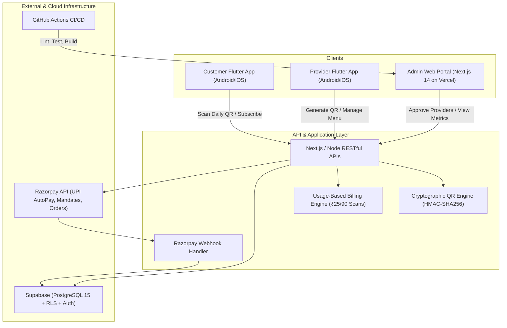
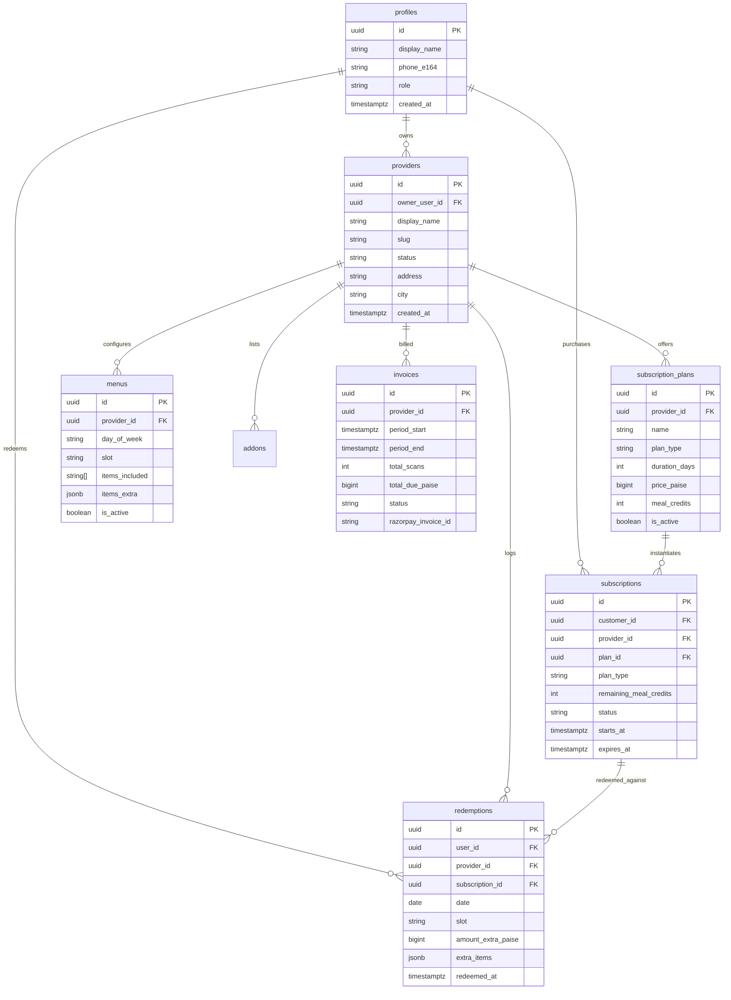

# Thali / MESS Platform

> **A Production-Grade Food Subscription & Mess Management Platform**  
> Brand: **MESS / Thali** · Tagline: *Your Meals. Your Choice.*  
> Live Web Deployment: [mess-beta.vercel.app](https://mess-beta.vercel.app)  
> GitHub Repository: [github.com/re-etikk/mess](https://github.com/re-etikk/mess)

---

## 1. Executive Summary

Thali (branded as MESS) is a full-featured, Swiggy/Zomato–level food subscription and mess-management ecosystem designed for students, working professionals, and food mess operators.

It provides:
- **Two Subscription Models & Daily Pass**:
  1. **Fixed-Period Plan**: Duration-based access (15d, 1m, 3m, 6m, 12m), unlimited meal visits for the period, 1 scan per slot per day recorded.
  2. **Meal-Tracker Plan**: Balance-based credit pack (e.g. 60 meals), deducts exactly 1 credit per redemption, auto-expires when balance reaches 0 or validity lapses.
  3. **Daily Meal Purchase**: Instant pay-per-meal option.
- **Cryptographic QR Redemption Flow**: Server-signed daily QR tokens using HMAC-SHA256 with 1-day validity, slot auto-selection (Breakfast/Lunch/Snacks/Dinner), and atomic idempotency preventing race conditions and double-scans.
- **Meal Inclusions & Optional Paid Extras**: Base regular thali inclusions (e.g., Dal, Rice, 4 Rotis, Sabzi) plus optional paid extras (e.g. Paneer Butter Masala +₹40, Extra Roti +₹15) charged upon checkout or scan.
- **Usage-Based Provider Billing**: Automated ledger calculating ₹25 per 90 successful scans with Razorpay UPI AutoPay recurring mandate charging and invoice generation.
- **Enterprise Security**: PostgreSQL Row-Level Security (RLS) on Supabase, zero secrets in client bundles, and OWASP-compliant input validation.
- **Multi-Platform Experience**: Next.js 14 Web & Admin Console, Flutter Customer Mobile App, and Flutter Provider Partner App with custom launcher icons.

---

## 2. Architecture & Data Flow



---

## 3. Data Model & ER Schema



---

## 4. RESTful API Specification

### Authentication
- `POST /api/auth/register`: Register as `customer`, `provider`, or `admin`.
- `POST /api/auth/login`: Authenticate with email and password.
- `POST /api/auth/logout`: Invalidate session.

### Customer Endpoints
- `GET /api/customer/dashboard`: Active subscription status, remaining credits/validity, today's menu, and recent redemption history.
- `GET /api/mess/search?q=...&city=...&cuisine=...&dietary=...&sort=...`: Search messes by name, food item, locality, or cuisine with dietary filters and sorting (`rating`, `distance`, `popular`).
- `GET /api/mess/:id/menu?slot=...`: Today's menu with included items and optional paid extras with prices.
- `POST /api/subscription/subscribe`: Subscribe to Fixed-Period or Meal-Tracker plan with optional promo code discount.
- `POST /api/subscription/renew`: Renew an expired or existing subscription.
- `POST /api/meal/daily_purchase`: Buy a single daily meal pass.
- `GET /api/mess/reviews?provider_id=...` & `POST /api/mess/reviews`: Read and submit customer reviews (1-5 stars, comments, photo URLs).
- `POST /api/promos/validate`: Validate promo codes (e.g. `WELCOME10`, `STUDENT50`) and calculate instant discounts.
- `GET /api/notifications` & `PATCH /api/notifications`: Retrieve and mark customer alerts (low meal credits, subscription renewal reminders).
- `GET /api/announcements`: Broadcast banners and promotional campaigns (e.g., "Midnight Meal 20% off").

### QR Code & Redemption
- `POST /api/scan`: Scan provider QR code token to redeem meal.
  - **Body**: `{ "token": "<token>", "user_id": "<uuid>", "extras": [{"name": "Paneer", "price": 40}] }`
  - **Checks**: HMAC signature verification, date validity, current meal slot matching, idempotency (rejects double scans for same slot on same day), credit decrement for tracker plans, and extra items charge calculation.
  - **Response**: `{ "success": true, "slot": "LUNCH", "remaining_credits": 9, "amount_extra": 40, "message": "Meal successfully redeemed!" }`

### Provider Endpoints
- `GET /api/provider/dashboard`: Today's scan count, unbilled scan ledger, active subscriber count, and active QR token.
- `POST /api/provider/qr/generate`: Generate signed daily Counter QR code token.
- `GET /api/provider/plans` & `POST /api/provider/plan`: Create and list subscription plans (Fixed, Tracker, Daily).
- `PUT /api/provider/plan/:id`: Update plan duration, pricing, and active status.
- `GET /api/provider/menu` & `POST /api/provider/menu`: Configure base menu inclusions and optional extras with prices.
- `GET /api/provider/subscriptions`: List all active subscribers and their plan types.
- `GET /api/provider/redemptions`: Real-time attendance and scan ledger.
- `GET /api/provider/reports`: Attendance breakdown by slot, extra revenue, and billing statements.
- `POST /api/provider/checkin`: Manual/backup student check-in by provider scanning student ID or QR.

### Admin & Billing Endpoints
- `GET /api/admin/metrics`: Platform-wide GMV, total redemptions, active subscriptions, and unbilled scans.
- `GET /api/admin/providers`: Provider onboarding queue.
- `POST /api/admin/approve_provider`: Approve, reject, or suspend a provider business application.
- `GET /api/admin/users`: User directory with roles.
- `GET /api/admin/subscriptions`: Global subscriptions audit.
- `POST /api/billing/cron`: Automated usage-based billing job: scans unbilled redemptions, computes ₹25 per 90 scans, generates invoice, and triggers Razorpay recurring charge.
- `POST /api/webhooks/razorpay`: Verifies `x-razorpay-signature` and handles payment and subscription lifecycle events.

---

## 5. Mobile Applications (Flutter)

1. **MESS Customer App (`apps/mobile_customer`)**:
   - Location discovery & mess search.
   - Live subscription status (Fixed duration countdown or Tracker credit counter).
   - In-app QR camera scanner.
   - Menu browser with customizable extras.
   - Built Android APK: `apps/mobile_customer/build/app/outputs/flutter-apk/app-arm64-v8a-release.apk` (27.8 MB)

2. **MESS Partner Provider App (`apps/mobile_provider`)**:
   - 5-step provider onboarding wizard (business details, location & timings, meal slots, plans & pricing, menu & portions).
   - Live Daily Signed Counter QR generator (display on physical counter).
   - Real-time meal redemption attendance ledger.
   - Built Android APK: `apps/mobile_provider/build/app/outputs/flutter-apk/app-arm64-v8a-release.apk` (19.5 MB)

---

## 6. Testing & Quality Assurance

- **Vitest Test Suite (`apps/web`)**: 30/30 tests passing across 3 test suites covering QR cryptography, tracker deductions, idempotency, extras charges, ₹25/90 scans billing, webhook validation, reviews & ratings, promo code engine, notifications, and student check-in.
- **Flutter Test Suite**: All unit and widget tests passing across customer and provider apps.
- **CI/CD Pipeline**: Automated GitHub Actions workflow (`.github/workflows/ci.yml`) runs linting, tests, and build checks on every push to `main`.

---

## 7. Development Quickstart

### Prerequisites
- Node.js 20+
- Flutter 3.41+ & Android SDK 37+

### Run Next.js Web App
```sh
cd apps/web
npm install
npm test
npm run dev
```

### Run Customer Mobile App
```sh
cd apps/mobile_customer
flutter test
flutter run
```

### Run Provider Mobile App
```sh
cd apps/mobile_provider
flutter test
flutter run
```
