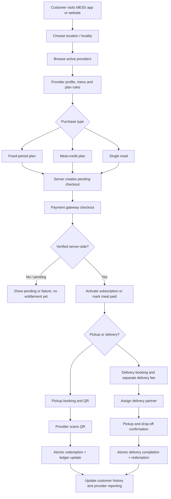

# 03 — App and Website Flows

## 1. System-level journey

## 2. Customer mobile app flow

1. Splash → onboarding/permissions only when necessary.
2. Sign up/sign in → profile → location permission or manual locality/address.
3. Home → search/filter → provider list → provider detail.
4. Provider detail → plans/menu → plan policy screen.
5. Choose plan and intended fulfillment preference (provider may require pickup or allow delivery).
6. Checkout shows item/plan price, discount, delivery fee if any, taxes, total, refund/cancellation policy, plan expiry and included meal rules.
7. Payment gateway → server verification → success/pending/failure screen.
8. Active plan screen displays status, start/expiry timestamp, fixed-period eligibility or remaining credits, daily/slot limits and next actions.
9. Book meal → choose date/slot → pickup/delivery → confirm booking.
10. Pickup: open QR → provider scans → success state refreshes.
11. Delivery: address and delivery quote → pay any delivery fee → order tracking timeline → secure drop-off confirmation → completed state.
12. History/receipts/support/renewal/profile.

**Error paths:** payment pending, expired plan, no capacity, provider closed, slot cutoff passed, out-of-service-area address, QR expired, network failure, delivery partner unavailable and refund requested. All paths need explicit recovery.

## 3. Customer website flow

### Public routes
- `/` home and locality search.
- `/explore` provider discovery.
- `/providers/[slug]` provider details, menu and plans.
- `/plans/[id]` optionally dedicated plan detail.
- `/how-it-works`, `/faq`, `/contact`, `/about`.
- `/terms`, `/privacy`, `/cancellation-refunds`.

### Authenticated customer routes
- `/account` overview.
- `/account/subscriptions` and `/account/subscriptions/[id]`.
- `/account/bookings` and `/account/bookings/[id]`.
- `/checkout/[sessionId]` (server-created checkout session; never accepts trusted amounts from URL).
- `/account/addresses`, `/account/payments`, `/account/support`, `/account/settings`.

The website may display a QR only for the authenticated owner of the eligible booking. If QR scanning is app-only initially, website should deep-link to the customer app or show a safe booking reference; do not create an unprotected QR URL.

## 4. Provider app flow

1. Sign in → check role, membership and provider approval status.
2. If no provider is assigned: application onboarding and document upload.
3. Pending approval screen until admin approves.
4. Provider home: today's slots, booking counts, meals ready, redemption activity and current incidents.
5. Scan QR → permission request → scan result.
6. Backend result: valid/invalid/already used/expired/wrong provider/unpaid/ineligible plan/capacity or schedule mismatch.
7. On success show customer initials/reference, meal slot and exact result; avoid unnecessary personal data.
8. Plan/menu management → draft → preview → publish/pause.
9. Booking list → ready/closed controls where allowed.
10. Delivery requests → accept/mark food ready/handover to assigned partner.
11. Earnings → commission and refunds → net payable → settlement status.
12. Support and settings.

Counter staff may scan/redeem but cannot edit bank/payout details or commission terms. Only provider owner/manager can change authorised business settings.

## 5. Provider website portal flow

- `/provider/onboarding`
- `/provider/overview`
- `/provider/profile`
- `/provider/menu`
- `/provider/plans`
- `/provider/slots-hours`
- `/provider/bookings`
- `/provider/redemptions`
- `/provider/customers`
- `/provider/delivery`
- `/provider/earnings`
- `/provider/settlements`
- `/provider/team`
- `/provider/support`

All route data must be scoped to the current provider membership. A user belonging to Provider A must not read or modify Provider B by changing an ID in the URL.

## 6. Delivery app flow

1. Sign in → partner verification status.
2. Pending/approved states.
3. Go online → receive eligible offered assignment.
4. Review pickup area, drop-off locality, estimated distance/payout and required timing. Do not expose full address before assignment acceptance unless operationally required.
5. Accept/reject → backend checks partner availability, assignment status and idempotency.
6. Navigate → arrive at provider → confirm pickup.
7. Deliver to customer → collect/validate OTP or delivery QR.
8. Server validates assigned partner, order, OTP expiry, booking state and duplicate completion.
9. Mark delivered; backend records completion and, if applicable, meal redemption/credit deduction.
10. Delivery history, payout ledger, issues/support.

If the partner has no network, allow only a clearly marked retry/pending state. Never show delivery completed until server verification succeeds.

## 7. Admin website flow

1. Admin authenticates with protected access.
2. Overview: pending providers/riders, unresolved tickets, disputed payments, active deliveries and payout/reconciliation exceptions.
3. Review provider application/document status → approve/reject/request correction with audit note.
4. Review delivery partner eligibility.
5. Search users/provider/subscription/booking/payment by safe identifiers.
6. Investigate QR/meal redemption without exposing raw tokens.
7. Approve or record a refund through supported workflow; never manually mutate a gateway payment state.
8. Configure platform promotion and commission rules with effective dates.
9. Ensure provider accepted terms before new commission becomes effective.
10. Review settlement ledger and reconciliation.
11. Manage support ticket and issue resolution.
12. Inspect audit trail.

Admin overrides require explicit reason, permission and audit log. Financial corrections should be reversal/adjustment ledger entries, not silent edits.

## 8. State machines

### Subscription
`pending_payment → active → paused (optional) → active → expired`  
Additional terminal/exception states: `cancelled`, `refund_pending`, `refunded`, `payment_failed`.

- Only verified payment makes a paid subscription active.
- Fixed-period expiry is server-derived with exclusive `expires_at`.
- Pause/extension rules must be explicit and auditable; do not change expiry from the client.

### Meal booking
`draft → pending_payment (single meal or delivery fee) → confirmed → ready → redeemed` for pickup.  
Delivery: `draft → pending_payment → confirmed → assigned → accepted → picked_up → delivered`.  
Other allowed outcomes: `cancelled`, `missed`, `failed_delivery`, `refund_pending`, `refunded`.

A booking may be redeemed only once. Delivery completion and entitlement deduction are idempotent. A mere transition to `ready` does not redeem a meal.

### Delivery assignment
`offered → accepted → picked_up → delivered`; exceptions include `rejected`, `cancelled`, `failed`, `reassigned`. Reassignment must invalidate previous partner update authority.

### Payment
`created → pending → succeeded` or `failed`; a successful transaction may later be associated with a separate refund record. Do not overwrite a succeeded payment to failed because of a late duplicate webhook.

## 9. Design/interaction principles

- Always show what is included in a plan and whether delivery costs extra.
- Never show a successful scan/payment/delivery until backend confirmation.
- Use meaningful empty/error/loading states.
- Confirm irreversible actions such as cancel/refund/commission changes.
- Maintain accessibility, readable contrast and low-friction interaction on mid-range Android devices.
