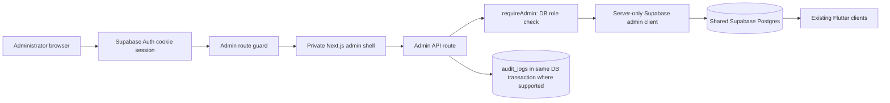

# Thali Super Admin Architecture

## Constraints and decisions

- Keep the current Next.js App Router and Supabase project; no second identity store, database, service, or client-side service-role access.
- The panel is unlinked from public navigation and `noindex`; its server layout checks a live Supabase session and a non-revoked DB `admin` role. Each `/api/admin/*` handler checks authorization again.
- Admin list APIs use server-side filtering, sorting, and bounded pagination. Sensitive PII is minimized/masked by default. Admin mutations require Zod validation, a reason for sensitive actions, confirmation in UI, and a durable audit record.
- Business and finance actions remain read-only/fail-closed until the current schema, payment/webhook path, and transaction/audit behavior are verified in staging.
- Current `app_role` only supports coarse roles. The prompt's staff roles cannot be safely implemented through client-side checks; a migration and permission model will be required after staging schema verification.

## Request path

## Admin information architecture

- Overview: persisted counts, pending work, recent records, and clearly separated financial measures.
- Partners: review queue, approved/suspended directory, partner profile and trial controls.
- Customers: paginated directory and read-only customer context; blocking/refunds wait for policy/API support.
- Subscriptions: paginated status/validity/credit view; no manual credit or expiry edits.
- Orders & redemptions: persisted bookings and redemptions; failed scan analytics wait for a persisted scan-event source.
- Finance: payments, refunds, commissions, ledger, settlements, and reconciliation. Initially read-only, filtered and paginated.
- Support: persisted tickets with assignment/status controls only after safe audit-backed endpoint work.
- Governance: audit history, settings, and integration health; secrets are never rendered.

## Data flow and contracts

- React admin pages call same-origin `/api/admin/*` endpoints with `cache: no-store`.
- Route handlers derive actor ID from Supabase session; user IDs, role names, payment states, prices, and provider ownership supplied by the browser are not trusted.
- Zod validates query/body inputs. List responses return `{ success, page, page_size, total, items }` and do not load whole tables.
- Finance summaries use schema-backed aggregate definitions; no unbounded table download or conflation of GMV with platform revenue.
- Sensitive writes use a DB transaction/RPC that validates policy and writes `audit_logs`; until such a path is verified, the UI offers no mutation.

## Delivery phases

1. Audit/documentation and release boundary.
2. Admin shell, route guard, accessible navigation, shared table/empty/error states.
3. Overview and partner review/billing using verified endpoints.
4. Read-only paginated customer, subscription, order, redemption, transaction, settlement and support views.
5. Safe operations: audit-backed provider changes, support workflow, policy-supported subscription/refund/settlement actions.
6. Fine-grained staff permissions, MFA/session revocation, audit review, integration health, and remaining domains after additive migration review.

## Deployment

Feature branch → Vercel preview → staging database/schema validation → permission and regression verification → PR review → production merge only after explicit release approval. Preview readiness alone is not production readiness.
