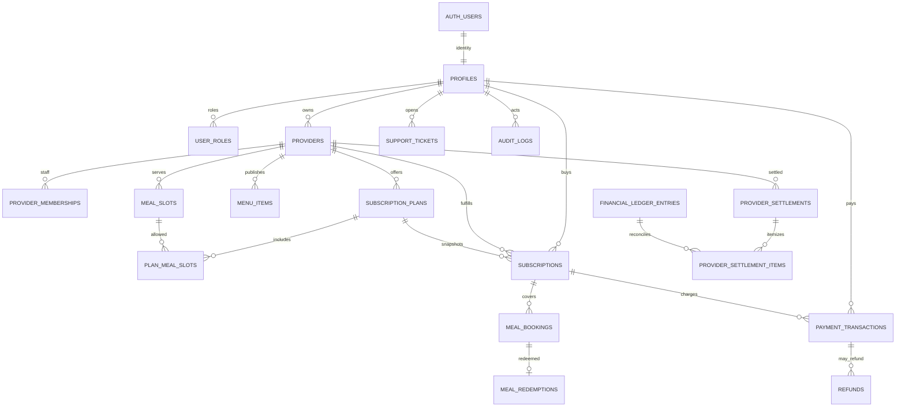

# Thali Admin Database Map

## Relationship overview

## Table inventory by domain

| Domain | Tables | Admin implication |
|---|---|---|
| Identity | `profiles`, `user_roles`, `customer_addresses` | User list is possible; safe block/unblock is not (no account status column/policy). Auth email lookup requires privileged Auth API and should be permission-scoped. |
| Partner | `providers`, `provider_memberships`, `provider_compliance_documents`, `provider_service_areas`, `provider_operating_hours` | Approval, memberships, compliance review, hours, and areas can be inspected. Status enum is `draft/pending_review/active/rejected/suspended`; do not invent additional states. |
| Catalogue | `meal_slots`, `menu_items`, `subscription_plans`, `plan_meal_slots` | Existing partner-owned catalogue is source of truth. Additive web menu fields are migration-only until staging verification. |
| Subscription | `subscriptions` | Has status, plan snapshots, paid price, credits, validity, pause and cancellation timestamps. Do not update entitlement/validity from generic admin forms. |
| Booking/redemption | `meal_bookings`, `qr_redemption_tokens`, `meal_redemptions` | Booking lifecycle is `booking_status`; redemption is immutable event. No standalone failed-scan event table is present. |
| Payments/refunds | `payment_transactions`, `payment_webhook_events`, `refunds` | Actual payment enum: `created/pending/succeeded/failed/cancelled`; refund enum: `requested/pending/succeeded/failed/rejected`. Do not present unsupported partial/dispute states. |
| Finance | `platform_commission_rules`, `commercial_agreements`, `financial_ledger_entries`, `provider_settlements`, `provider_settlement_items`, `delivery_payouts` | Persisted source for effective commission and settlements; no audited payout/reconciliation admin workflow confirmed. |
| Support/communication | `support_tickets`, `notifications` | Tickets support status, priority, assignment, resolution note; list/action API is missing. No announcement/coupon/CMS tables found. |
| Governance | `audit_logs`, `idempotency_records`, `payment_webhook_events` | Audit table exists but application writes are not transactionally coupled to every mutation. No admin permission table or immutable DB policy confirmed. |
| Platform billing | `platform_billing_settings`, `provider_billing_accounts` | 30-day default trial and per-90-successful-redemption usage fee; billing disabled by default. Migration exists but is not recorded as applied in project migration history. |

## Confirmed enum and accounting semantics

- `app_role`: customer, provider, delivery_partner, admin, support.
- `provider_status`: draft, pending_review, active, rejected, suspended.
- `subscription_status`: pending_payment, active, paused, expired, cancelled, refund_pending, refunded, payment_failed.
- `payment_status`: created, pending, succeeded, failed, cancelled.
- `settlement_status`: draft, pending, processing, paid, failed, cancelled.
- Amounts are stored in integer paise; currency is INR.
- GMV, payment collection, platform commission, ledger balance, partner net payable, and paid settlements are separate measures.

## Migration caution

The repository contains a canonical baseline plus additive migrations, archived legacy SQL, and review drafts. The connected production project has no migration history recorded; schema changes must be tested against a staging database reconstructed from the actual live schema before release. Never replay the baseline onto the live project based only on filenames.
